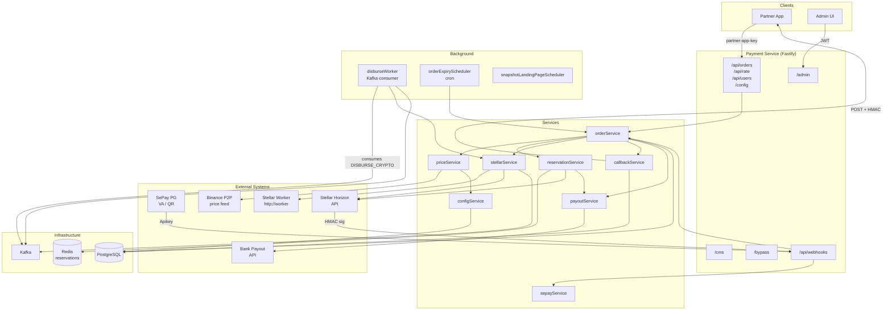
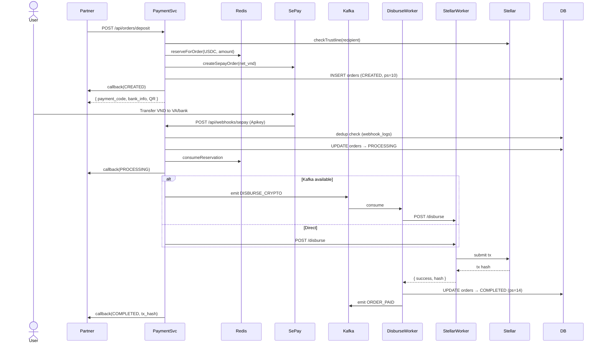
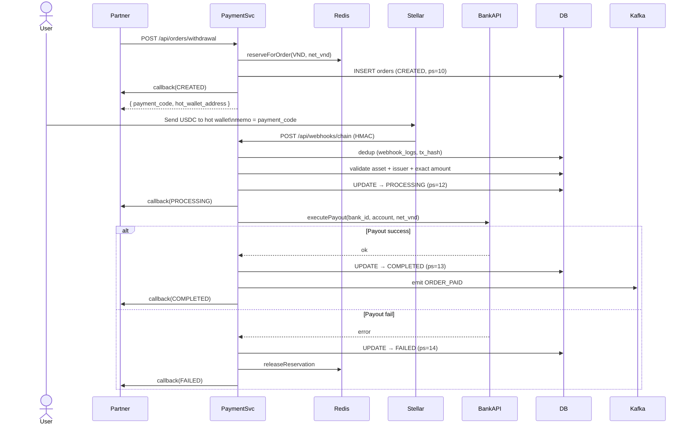
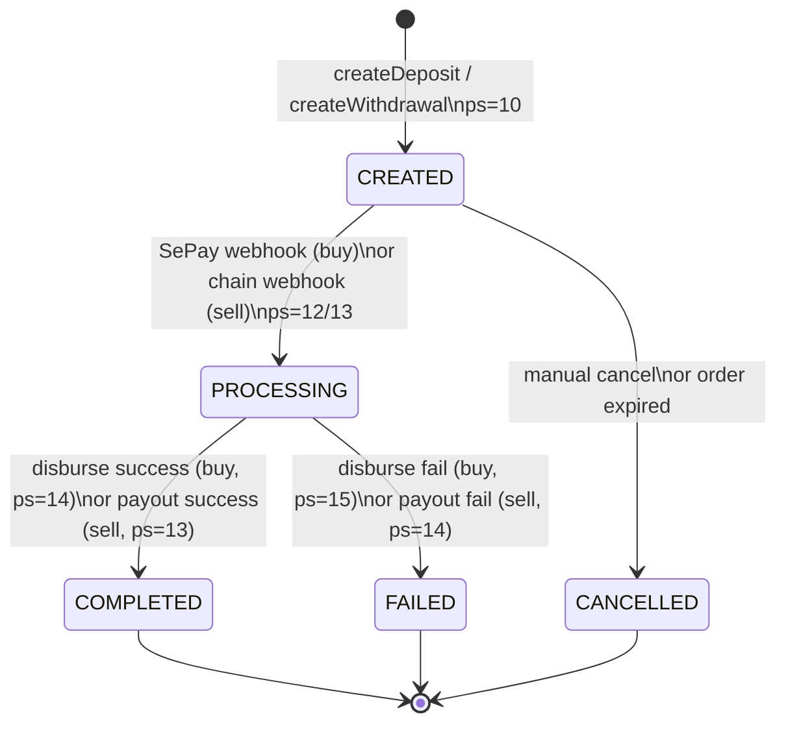

# Payment Service — System Overview

## What it is

A VND ↔ crypto exchange gateway. Partners integrate via API to let their users buy crypto (deposit VND → receive USDC/XLM on Stellar) or sell crypto (send USDC/XLM → receive VND payout).

## Core Concepts

| Concept | Description |
|---|---|
| **Direction** | `buy` = VND in → USDC/XLM out. `sell` = USDC/XLM in → VND out. |
| **Payment code** | `DH` + 10 alphanum (e.g. `DHA1B2C3D4E5`). Anchor for the entire order lifecycle. Used as SePay transfer description and Stellar memo. |
| **Reservation** | Redis-backed liquidity guard. Reserves the asset before order creation to prevent overselling. |
| **Order state** | `CREATED(1) → PROCESSING(2) → COMPLETED(3)` or `FAILED(4)` or `CANCELLED(5)` |
| **Processing state** | Sub-state within an order: 10=created, 12=sell payment received, 13=disburse triggered, 14=completed, 15=failed |

---

## Architecture

---

## Buy Flow (VND → USDC)

---

## Sell Flow (USDC → VND)

---

## Order State Machine

---

## Key Design Decisions

| Concern | Approach |
|---|---|
| Liquidity guard | Redis reservations with optimistic locking (WATCH/MULTI). Prevents overselling before order hits DB. Released on cancel/expiry, consumed on completion. |
| Disbursement | Kafka → DisburseWorker → StellarWorker (external HTTP). Falls back to direct call if Kafka unavailable. DisburseWorker retries up to 3× with backoff. |
| Deduplication | `webhook_logs.sepay_transaction_id` (buy) and `webhook_logs.tx_hash` (sell) prevent double-processing. |
| Callbacks | HMAC-SHA256 signed (`X-Signature`), 3 retries × 5s delay, dual-secret rotation with 5min overlap window. All attempts logged in `callback_logs`. |
| Pricing | Binance P2P median + configurable spread + fee (platform + per-partner). 30s in-memory cache. Fallback to CoinGecko. |
| Auth tiers | `partner-app-key` (order API) / `Apikey` (SePay webhook) / HMAC-SHA256 (chain webhook) / JWT (admin) |
| Order expiry | Scheduler periodically scans CREATED orders past `expired_at`, cancels them, and releases Redis reservations. |
| V2 APIs | `deposit_v2` / `withdrawal_v2` resolve `recipient` and `bank_info` from stored user + payment_method records instead of requiring them in each request. |

---

## Route Map

| Prefix | Auth | Purpose |
|---|---|---|
| `GET /health` | None | Health check |
| `/api/rate` | None | Price quotes |
| `/api/orders` | `partner-app-key` | Order CRUD (deposit, withdrawal, cancel, status) |
| `/api/users` | `partner-app-key` | User + payment method management |
| `/api/webhooks/sepay` | `Apikey` | SePay payment notifications |
| `/api/webhooks/chain` | HMAC-SHA256 | Stellar chain payment notifications |
| `/config` | JWT (writes) | Runtime config (spreads, fees, secrets) |
| `/admin` | JWT | Stats, secret rotation, bypass tools |
| `/cms` | — | CMS routes |
| `/landing` | — | Landing page snapshot |
| `/docs` | None | Swagger UI |

---

## Database Tables

| Table | Purpose |
|---|---|
| `orders` | All order records with full state history |
| `config` | Runtime config (spreads, fee rates, callback secrets) |
| `webhook_logs` | Deduplication log for SePay + chain webhooks |
| `callback_logs` | Per-attempt log for outbound callbacks |
| `fee_audit_log` | Audit trail for fee/spread changes |
| `system_wallets` | Encrypted Stellar hot wallet secrets (AES-256-GCM) |
| `admins` | Admin users for JWT auth |
| `partners` | Partner records with per-partner fee overrides |
| `users` | End-user records |
| `payment_methods` | User-stored crypto wallets and bank accounts |
